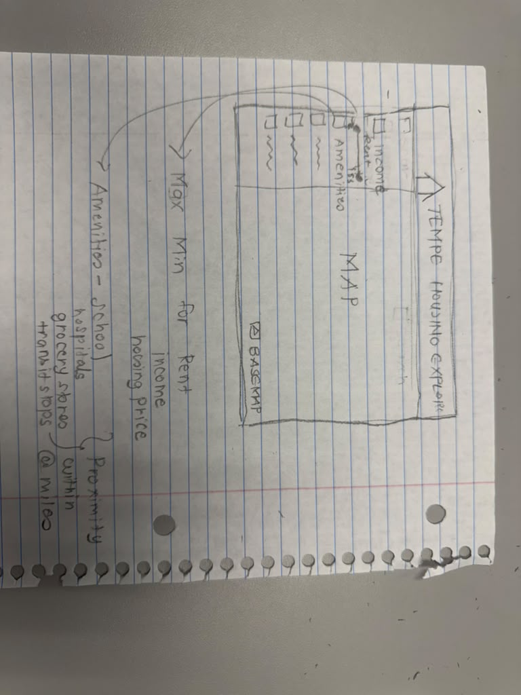
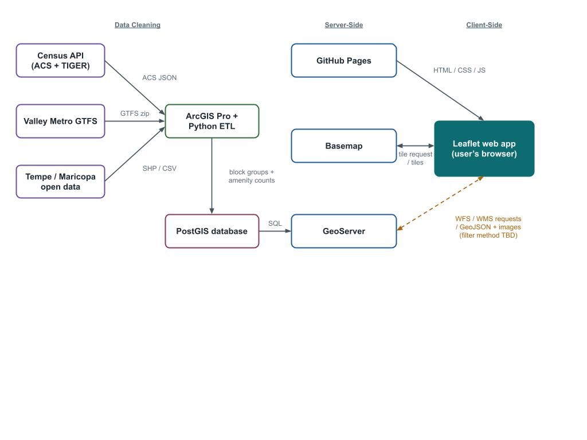

# Project Proposal - GIS 494/598
HomeScope Tempe: Explore Housing. Understand Neighborhoods.
An Interactive WebGIS Dashboard for Housing Affordability and Neighborhood Exploration in Tempe, Arizona

## Team Members

| Team Member | Course Level | Role |
|-------------|--------------|------|
| Nikita Soni | GIS 598 | Frontend UI Designer, Data Collector, Meeting Organizer |
| Farhan Abbas | GIS 598 | Frontend Developer |
| Arjav Rawal | GIS 494 | Backend Developer, Data Processor |
| Nathan DeJonge | GIS 494 | Backend Developer |

## Problem statement:

### The problem:
People looking for housing in Tempe often need to compare neighborhoods based on housing costs, demographic characteristics, and nearby amenities before deciding where to live. Tempe is a college town, and every year many students come to the city, while families and other residents are also looking for places to rent or buy. Finding a home is not only about the housing price or monthly rent. People may also want to know what kind of population lives in the area, whether most homes are rented or owned, and how close the neighborhood is to schools, grocery stores, parks, public transit, and other useful facilities. Right now, this information is scattered across different websites and data sources, so people often have to search several places before they can compare their options.

### The intended users:
People interested in moving to Tempe, regardless of whether they are students, families, or other residents, are the intended users of this dashboard. Anyone who is looking for housing-related information within Tempe can explore the dashboard and identify a census block group based on their housing budget, neighborhood characteristics, and preferences. 

### Why a WebGIS application is the right answer:
A WebGIS housing dashboard for Tempe brings this information together in one place. Users can explore the map, turn different layers on and off, apply filters, and compare areas based on their own preferences. For example, a student may be looking for lower rent, nearby grocery stores, and good transit access, while a family may be more interested in housing prices, schools, parks, and homeownership patterns. WebGIS is a useful approach for combining housing and demographic data with spatial information about nearby facilities, allowing users to explore and compare census block groups through an interactive map. 

### Functional requirements:

The HomeScope Tempe  dashboard will allow users to explore and compare census block groups based on housing costs, demographic characteristics, and nearby amenities. Users will be able to apply housing filters, interact with the map, and view detailed information about individual block groups. The main functional requirements are as follows:
1. Housing filters: Users should be able to enter minimum and maximum monthly rent values, and the dashboard should display census block groups where the median monthly rent falls within the specified range.
2. Housing and demographic information: Users should be able to view median home values and median household income for individual census block groups.
3. Interactive map: If a user clicks a specific census block group, a panel should appear on the dashboard displaying its housing and demographic information.
4. Nearby amenities: The panel should show how many transit stops, schools, grocery stores, and hospitals are located within a one-mile radius of the selected block group's centroid.
5. Map layers: Users should be able to turn different amenity layers on and off to explore nearby facilities.

### Wireframes:
Note: Depending on data availability, technological difficulties, and design considerations, this wireframe, which shows the initial dashboard layout, may vary during development. The Capstone Milestone Prototype will include any required modifications. 

### Architecture diagram:

### Team repository:

https://github.com/arjavrawal/webgis-final-project